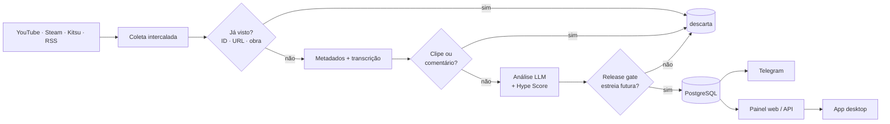

<div align="center">


# 📡 Release Radar

**Descubra o que vem por aí: filmes, séries, jogos e animes — antes de todo mundo.**

O bot varre trailers, notícias e páginas oficiais, uma LLM separa o que realmente
**ainda vai estrear**, e os links aprovados chegam no seu Telegram, no painel web e no
widget de desktop.

[](https://github.com/juninmd/release-radar/actions/workflows/build.yml)


</div>

---

**Índice:** [Destaques](#-destaques) · [Como funciona](#-como-funciona) · [Início rápido](#-início-rápido) · [Uso](#-uso) · [Fontes](#-fontes-e-configuração) · [Telas](#%EF%B8%8F-telas) · [Desktop](#%EF%B8%8F-app-desktop) · [API](#-api) · [Container](#-container) · [Operação](#%EF%B8%8F-resiliência-e-operação) · [Desenvolvimento](#-desenvolvimento) · [CI](#-gates-de-ci) · [Estrutura](#%EF%B8%8F-estrutura)

---

## ✨ Destaques

- 🎬 **Quatro categorias:** filmes, séries, jogos e animes.
- 🔌 **Várias fontes, sem chave de API:** YouTube, Steam, Kitsu, AniList, TVmaze e RSS, intercaladas a cada rodada
  (novas fontes na [proposta](docs/FONTES.md)).
- 🧠 **Análise com LLM** (qualquer API compatível com OpenAI) e **Hype Score** de 0 a 100.
- 🚦 **Release gate:** só publica com data futura ou confirmação de que a obra ainda vai estrear.
- 🧹 **Sem repetição:** dedupe por ID, URL, conteúdo e **mesma obra** (vários trailers → um post).
- 🗣️ **Transcrição opcional** de trailers via Whisper.
- 🖥️ **Painel web** + **widget desktop** sempre no topo (Tauri + React).
- 🔒 **Seguro por padrão:** proteção contra SSRF/XXE/CSRF, API com token fora do localhost.

## 🧭 Como funciona



Uma obra já lançada, ou com estreia hoje ou no passado, **não é publicada**. Datas explícitas
das fontes têm prioridade sobre a análise; sem a chave da LLM, Steam e Kitsu ainda indicam obra
futura, mas YouTube e RSS precisam de evidência adicional (`Estreia futura nao confirmada`).

## 🚀 Início rápido

Requisitos: Python 3.11+, [uv](https://docs.astral.sh/uv/) e PostgreSQL
(ffmpeg e um serviço Whisper só para transcrever áudio).

```bash
git clone https://github.com/juninmd/release-radar.git && cd release-radar
uv sync --locked
cp .env.example .env        # preencha POSTGRES_*, LLM_* e TELEGRAM_*

uv run release-radar run --dry-run --limit 3   # teste: não grava nem publica
uv run release-radar run --limit 12            # rodada real
uv run release-radar web                       # http://127.0.0.1:8765
```

`--json` devolve o resultado em JSON para automações. O painel escuta só em `localhost`;
para expor, defina `RELEASE_RADAR_API_TOKEN` e use `--host 0.0.0.0` atrás de HTTPS.

## 🧰 Uso

```bash
# 1. Teste seguro: busca e analisa, mas não grava nem publica (saída não verificada: exige PostgreSQL e LLM)
uv run release-radar run --dry-run --limit 3

# 2. Rodada real, resultado em JSON para automação (saída não verificada: exige PostgreSQL, LLM e Telegram)
uv run release-radar run --limit 12 --json

# 3. Painel web em http://127.0.0.1:8765 (saída não verificada: exige PostgreSQL)
uv run release-radar web --port 8765

# 4. Opções de cada subcomando (verificado, sem credencial)
uv run release-radar run --help
```

Saída real do `--help` (sem credenciais) em [`docs/terminal.txt`](docs/terminal.txt); trecho:

```text
usage: release-radar [-h] {run,web} ...

positional arguments:
  {run,web}
    run       Busca, analisa e publica anúncios de estreias futuras
    web       Inicia o painel de links publicados
```

Exemplo do contrato da API (fictício): [`docs/previews/api-example.json`](docs/previews/api-example.json).

## 🔌 Fontes e configuração

| Fonte | Categoria | Variáveis | Observação |
|---|---|---|---|
| YouTube | todas | `YOUTUBE_SOURCES`, `SOURCE_LIMIT` | Canais; única com transcrição de áudio |
| Steam | jogos | `STEAM_ENABLED`, `STEAM_LIMIT`, `STEAM_COUNTRY`, `STEAM_LANGUAGE` | Jogos "em breve" |
| Kitsu | animes | `KITSU_ENABLED`, `KITSU_LIMIT` | Animes `upcoming` |
| AniList | animes | `ANILIST_ENABLED`, `ANILIST_LIMIT` | GraphQL público, `NOT_YET_RELEASED` por popularidade |
| Jikan (MyAnimeList) | animes | `JIKAN_ENABLED`, `JIKAN_LIMIT` | Próxima temporada; desligada por padrão |
| Wikidata | filmes, jogos | `WIKIDATA_ENABLED`, `WIKIDATA_LIMIT`, `WIKIDATA_DAYS` | SPARQL público; só estreias com data de dia futura em todas as regiões; desligada por padrão |
| TVmaze | séries | `TVMAZE_ENABLED`, `TVMAZE_LIMIT`, `TVMAZE_DAYS` | Estreias (1x01) em streaming nos próximos dias |
| RSS / Atom | por feed | `RSS_SOURCES`, `RSS_LIMIT` | RSS 2.0, RDF e Atom |

Listas usam `categoria|endereço` separados por vírgula; categorias: `movies`, `series`,
`games`, `anime`. As variáveis principais estão em [`.env.example`](.env.example); a lista completa está em `config.py`.

Nenhuma fonte exige chave de API. As fontes rodam em paralelo e uma que falha não derruba as
outras (o erro é contado por fonte na rodada). **Em breve:** saídas `.ics`/webhook e
mais — veja a [proposta de novas fontes](docs/FONTES.md).

### Anti-bloqueio do YouTube

Para mitigar bloqueios ou restrições de IP na extração de vídeos via YouTube (yt-dlp), você pode configurar:
- `YOUTUBE_PLAYER_CLIENT`: clientes alternativos do YouTube separados por vírgula (ex.: `tv,mweb,web_safari`).
- `YOUTUBE_COOKIES_FILE`: caminho local para um arquivo de cookies em formato Netscape/cookies.txt (nunca versione arquivos de cookies).

## 🖼️ Telas

<table>
  <tr>
    <td></td>
    <td></td>
  </tr>
  <tr><td align="center">Painel (celular)</td><td align="center">Widget desktop</td></tr>
</table>

Capturas com dados fictícios, geradas pela UI real. Mais em [docs/ui-preview.md](docs/ui-preview.md).

## 🖥️ App desktop

Janela compacta sempre no topo, bandeja, notificações, atalho global `Ctrl+Shift+R`, skins e
atualização assinada. Consome a API do painel (não fala direto com banco nem Telegram).
Detalhes em [desktop/README.md](desktop/README.md).

## 🔗 API

| Rota | Acesso | Descrição |
|---|---|---|
| `GET /api/releases` | aberta | 120 links mais recentes publicados (cache de 15 s; campos detalhados em [`docs/previews/api-example.json`](docs/previews/api-example.json)) |
| `GET /api/health` | aberta | Saúde do serviço |
| `POST`/`GET /api/run` | token | Dispara e acompanha uma rodada |
| `GET`/`PUT /api/settings` | token | Fontes e limites editáveis |

Com `RELEASE_RADAR_API_TOKEN` definido, as rotas protegidas exigem
`Authorization: Bearer <token>`. Sem token, fora do localhost, respondem `403`
(`RELEASE_RADAR_ALLOW_ANON=true` libera conscientemente). Tokens do Telegram, chaves da LLM e
transcrições nunca saem pela API.

Nas rotas de escrita e de gerência do painel (`/api/settings` e `/api/run`), requisições sem token
validam os cabeçalhos `Host` e `Origin` para prevenir ataques de DNS rebinding. Por padrão,
apenas `localhost` / `127.0.0.1` e o host de bind do servidor são permitidos; hosts adicionais
podem ser informados em `RELEASE_RADAR_ALLOWED_HOSTS` (separados por vírgula).

## 🐳 Container

A imagem roda sem privilégios (usuário `radar`) e executa uma rodada do bot por padrão.
Para subir tudo localmente (PostgreSQL + painel em http://127.0.0.1:8765):

```bash
docker compose up -d db web
docker compose run --rm bot                       # uma rodada do bot
docker compose run --rm bot release-radar run --dry-run --verbose
```

Fora do Compose, sirva o painel com `release-radar web --host 0.0.0.0 --port 8765`;
`GET /healthz` confere o banco e serve de probe de liveness/readiness.

## 🛡️ Resiliência e operação

- **Retry com backoff** (exponencial, com jitter e `Retry-After`) em fontes HTTP, Whisper e LLM.
- **Circuit breaker por rodada:** falhas seguidas do Whisper desligam a transcrição; da LLM
  interrompem a rodada (`aborted: llm_unavailable`).
- **Estatísticas por rodada** (`--json` ou log `Run finished`): candidatos e falhas por fonte, tempos.
- `LOG_FORMAT=json` emite logs JSON, prontos para Loki/Datadog/CloudWatch.
- **Migrações** versionadas em `src/release_radar/sql/NNNN_nome.sql`, aplicadas na inicialização
  com advisory lock; nunca edite uma migração já aplicada.
- **API do painel:** pool de conexões, cache de 15 s (serve o último resultado se o banco cair),
  limite de requisições por IP (`429` com `Retry-After`), `ETag` nos estáticos.

## 🧪 Desenvolvimento

```bash
uv run ruff check . && uv run ruff format --check . && uv run mypy
uv run pytest -q && uv build
```

O painel é TypeScript (`frontend/src/app.ts`) compilado para `src/release_radar/static/app.js`
(versionado). Após editar o `.ts`: `cd frontend && npm ci && npm run check`. A CI falha se o
`app.js` divergir do gerado.

Testes de banco usam `RELEASE_RADAR_TEST_DSN` (schema isolado por teste) ou `pgserver`;
testes de navegador exigem `uv sync --locked --group browser` e Chromium. Nenhum teste acessa
fontes externas ou o Telegram. A CI roda lint, formatação, mypy, frontend, testes e build, e a
imagem só é publicada se tudo passar. Veja [CONTRIBUTING.md](CONTRIBUTING.md).

## ✅ Gates de CI

| Workflow | Quando | O que checa |
|---|---|---|
| `build.yml` (Build) | PR e `workflow_call` | `ruff check`, `ruff format --check`, `mypy`, frontend (`npm run check`), `app.js` em dia, Chromium + `pytest`, `uv build` |
| `desktop.yml` (Desktop) | PR/push em `desktop/**` | `bun run lint`, `bun test`, `bun run build`, `cargo fmt --check`, `cargo clippy -D warnings`, `cargo test` |
| `validate.yml` (Validate) | PR e push em `main` | validação padrão do reusable `juninmd/base-actions` |
| `security.yml` (Security Scan) | push em `main`, semanal, manual | varredura de segurança do reusable `juninmd/base-actions` |
| `docker.yml` (Build and Push Docker Image) | push em `main`, manual | build e publicação da imagem via reusable `juninmd/base-actions` |

## 🗂️ Estrutura

```
src/release_radar/   bot, pipeline, fontes, API e painel web
  sources/           steam, kitsu, anilist, jikan, tvmaze, wikidata, rss
  sql/               migrações do banco
frontend/            TypeScript do painel (compila para static/)
desktop/             app Tauri v2 + React
scripts/             ferramentas manuais (sondas)
tests/               pytest (banco, API, fontes, navegador)
docs/                capturas e proposta de fontes
```

## 🔐 Segurança

Veja [SECURITY.md](SECURITY.md) para reportar vulnerabilidades de forma privada.
Nunca versione `.env`, tokens ou chaves.

## 📄 Licença

[MIT](LICENSE).
