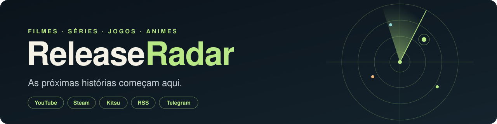
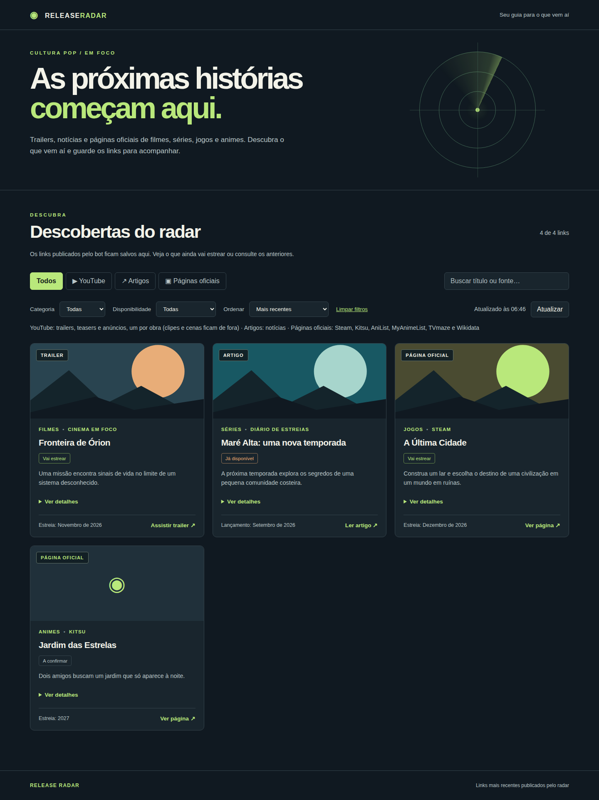
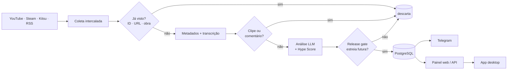
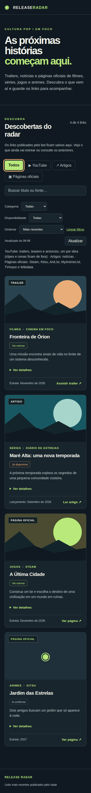
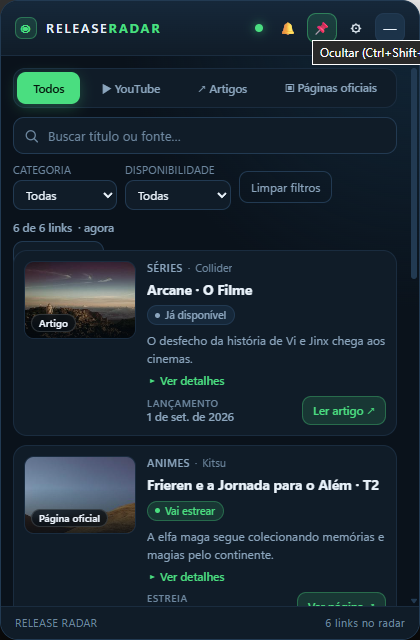

<div align="center">



# 📡 Release Radar

**Descubra o que vem por aí: filmes, séries, jogos e animes — antes de todo mundo.**

O bot varre trailers, notícias e páginas oficiais, uma LLM separa o que realmente
**ainda vai estrear**, e os links aprovados chegam no seu Telegram, no painel web e no
widget de desktop.

[](https://github.com/juninmd/release-radar/actions/workflows/build.yml)
[](https://github.com/juninmd/release-radar/actions/workflows/desktop.yml)


[](LICENSE)



</div>

---

**Índice:** [Destaques](#destaques) · [Como funciona](#como-funciona) · [Início rápido](#início-rápido) · [Uso](#uso) · [Fontes](#fontes-e-configuração) · [Variáveis](#variáveis-de-ambiente) · [Telas](#telas) · [Desktop](#app-desktop) · [API](#api) · [Container](#container) · [Operação](#resiliência-e-operação) · [Desenvolvimento](#desenvolvimento) · [CI](#gates-de-ci) · [Estrutura](#estrutura) · [Limitações](#limitações) · [Licença](#licença)

---

## Destaques

- 🎬 **Quatro categorias:** filmes, séries, jogos e animes.
- 🔌 **Várias fontes, sem chave de API:** YouTube, Steam, Kitsu, AniList, TVmaze, Wikidata e RSS, intercaladas a cada rodada
  (novas fontes na [proposta](docs/FONTES.md)).
- 🧠 **Análise com LLM** (qualquer API compatível com OpenAI) e **Hype Score** de 0 a 100.
- 🚦 **Release gate:** só publica com data futura ou confirmação de que a obra ainda vai estrear.
- 🧹 **Sem repetição:** dedupe por ID, URL, conteúdo e **mesma obra** (vários trailers → um post).
- 🗣️ **Transcrição opcional** de trailers via Whisper.
- 🖥️ **Painel web** + **widget desktop** sempre no topo (Tauri + React).
- 🔒 **Seguro por padrão:** proteção contra SSRF/XXE/CSRF, API com token fora do localhost.

## Como funciona



Uma obra já lançada, ou com estreia hoje ou no passado, **não é publicada**. Datas explícitas
das fontes têm prioridade sobre a análise. Sem `LLM_API_KEY`, o radar cai num heurístico:
as fontes de catálogo (Steam, Kitsu, AniList, TVmaze, Jikan e Wikidata) seguem como
`upcoming`; YouTube e RSS só passam com sinal de anúncio no título e data futura na
descrição.

Cada rodada busca um número limitado de itens por fonte (`SOURCE_LIMIT`, padrão 10),
intercala as fontes e analisa no máximo `MAX_ITEMS_PER_RUN` (padrão 20).

## Início rápido

**Só ver o painel, sem configurar banco, fontes externas ou Telegram** — o script sobe um
PostgreSQL efêmero, semeia lançamentos fictícios e serve a API:

```bash
git clone https://github.com/juninmd/release-radar.git
cd release-radar
uv sync --locked
uv run --with pgserver python desktop/scripts/local_api.py
# painel em http://127.0.0.1:8765
```

Para rodar o bot de verdade, você precisa de um PostgreSQL e de um `.env`:

```bash
uv sync --locked
cp .env.example .env          # no PowerShell: Copy-Item .env.example .env
# preencha POSTGRES_* e, se quiser Telegram/LLM, TELEGRAM_* e LLM_*
uv run release-radar run --dry-run --limit 3   # busca e analisa; não grava nem publica
uv run release-radar web                       # http://127.0.0.1:8765
```

Se já tiver um PostgreSQL local, basta apontar `POSTGRES_HOST`, `POSTGRES_PORT`,
`POSTGRES_DB`, `POSTGRES_USER` e `POSTGRES_PASSWORD` no `.env`. Para usar o banco do
Compose com o bot rodando na máquina, defina `POSTGRES_PASSWORD=radar_local` (o padrão
do `docker-compose.yml`).

`--json` devolve o resultado da rodada em JSON para automações. O painel escuta só em
`localhost`; para expor, defina `RELEASE_RADAR_API_TOKEN` e use `--host 0.0.0.0` atrás de
HTTPS.

Requisitos: Python 3.11+, [uv](https://docs.astral.sh/uv/) e PostgreSQL. `ffmpeg` e um
serviço compatível com Whisper só são necessários para transcrever áudio.

## Uso

```bash
# 1. Teste seguro: busca e analisa, mas não grava nem publica
#    (exige PostgreSQL; LLM é opcional e cai no heurístico)
uv run release-radar run --dry-run --limit 3

# 2. Rodada real, resultado em JSON para automação
uv run release-radar run --limit 12 --json

# 3. Painel web em http://127.0.0.1:8765
uv run release-radar web --port 8765

# 4. Opções de cada subcomando
uv run release-radar run --help
```

Saída real do `--help` (sem credenciais) em [`docs/terminal.txt`](docs/terminal.txt); trecho:

```text
usage: release-radar [-h] {run,web} ...

positional arguments:
  {run,web}
    run       Busca, analisa e publica anúncios de estreias futuras
    web       Inicia o painel de links publicados
```

A tabela final da rodada usa estes rótulos, na ordem:

```text
Links encontrados · Novos links registrados · Itens analisados · Publicados no Telegram
Já encontrados anteriormente · Sem anúncio de estreia · Já lançados
Estreia futura não confirmada · Clipes e comentários · Trailer de obra já publicada
Falhas de processamento
```

### Publicar no Telegram

Preencha `TELEGRAM_BOT_TOKEN` e `TELEGRAM_CHAT_ID`. A publicação usa foto de capa quando
a fonte oferece miniatura e envia o texto com o Hype Score. **Sem essas duas variáveis a
rodada analisa e grava os itens, mas nenhum é entregue** — e o item fica registrado como
visto, então não é reenviado na rodada seguinte.

## Fontes e configuração

| Fonte | Categoria | Variáveis | Observação |
|---|---|---|---|
| YouTube | todas | `YOUTUBE_SOURCES`, `SOURCE_LIMIT` | Canais; única com transcrição de áudio |
| Steam | jogos | `STEAM_ENABLED`, `STEAM_LIMIT`, `STEAM_COUNTRY`, `STEAM_LANGUAGE` | Jogos "em breve" |
| Kitsu | animes | `KITSU_ENABLED`, `KITSU_LIMIT` | Animes `upcoming` |
| AniList | animes | `ANILIST_ENABLED`, `ANILIST_LIMIT` | GraphQL público, `NOT_YET_RELEASED` por popularidade |
| Jikan (MyAnimeList) | animes | `JIKAN_ENABLED`, `JIKAN_LIMIT` | Próxima temporada; desligada por padrão |
| Wikidata | filmes, jogos | `WIKIDATA_ENABLED`, `WIKIDATA_LIMIT`, `WIKIDATA_DAYS` | SPARQL público; só estreias com data futura em todas as regiões; desligada por padrão |
| TVmaze | séries | `TVMAZE_ENABLED`, `TVMAZE_LIMIT`, `TVMAZE_DAYS` | Estreias (1x01) em streaming nos próximos dias |
| RSS / Atom | por feed | `RSS_SOURCES`, `RSS_LIMIT` | RSS 2.0, RDF e Atom |

Listas usam `categoria|endereço` separados por vírgula; categorias: `movies`, `series`,
`games`, `anime`. Nenhuma fonte exige chave de API. As fontes rodam em paralelo e uma que
falha não derruba as outras (o erro é contado por fonte na rodada).

Duas fontes vêm desligadas por motivo declarado no próprio projeto: a **Jikan** não foi
verificada contra a API real durante o desenvolvimento, e a **Wikidata** recebeu `403`
(política anti-bot do Wikimedia) no cliente HTTP mesmo com o `User-Agent` usado no `curl`.
Ative com `JIKAN_ENABLED=true` / `WIKIDATA_ENABLED=true` e confira os logs.

### Anti-bloqueio do YouTube

A extração usa `yt-dlp`, que é a parte mais frágil do pipeline. Para mitigar bloqueios ou
restrições de IP:

- `YOUTUBE_PLAYER_CLIENT`: clientes alternativos do YouTube separados por vírgula (ex.: `tv,mweb,web_safari`).
- `YOUTUBE_COOKIES_FILE`: caminho local para um arquivo de cookies em formato Netscape/cookies.txt (nunca versione arquivos de cookies).

## Variáveis de ambiente

O `.env.example` traz a lista comentada; `src/release_radar/config.py` é a fonte da
verdade. As principais:

| Variável | Padrão | Para que serve |
|---|---|---|
| `YOUTUBE_SOURCES` | 30 canais no código; 6 no `.env.example` | Canais no formato `categoria\|@canal` |
| `SOURCE_LIMIT` | `10` | Itens por fonte em cada rodada |
| `MAX_ITEMS_PER_RUN` | `20` | Teto de itens analisados por rodada (a flag `--limit` sobrepõe) |
| `RSS_SOURCES` / `RSS_LIMIT` | 14 feeds no código; 7 no `.env.example` / `5` | Feeds de notícia no mesmo formato |
| `STEAM_*`, `KITSU_*`, `ANILIST_*`, `JIKAN_*`, `TVMAZE_*`, `WIKIDATA_*` | — | Liga/desliga e limites de cada fonte |
| `HTTP_TIMEOUT` | `20.0` | Timeout das requisições HTTP, em segundos |
| `LLM_BASE_URL` | `http://localhost:4000/v1` | Qualquer endpoint compatível com OpenAI |
| `LLM_MODEL` / `LLM_API_KEY` | `gpt-4o-mini` / vazio | Modelo e chave; sem chave, usa o heurístico |
| `LLM_TIMEOUT` | `120.0` | Timeout da análise |
| `WHISPER_BASE_URL` | `http://localhost:9000` | Serviço de transcrição compatível com Whisper |
| `MAX_TRANSCRIPTION_SECONDS` | `420` | Acima disso, o vídeo não é baixado para transcrever |
| `ANALYZE_VIDEO_CONTENT` | `true` | Liga a etapa de análise de conteúdo |
| `TELEGRAM_BOT_TOKEN` / `TELEGRAM_CHAT_ID` | vazio | Destino da publicação |
| `POSTGRES_HOST` / `PORT` / `DB` / `USER` / `PASSWORD` | `localhost` / `5432` / `release_radar` / `postgres` / vazio | Conexão do banco |
| `LOG_FORMAT` | `text` | `text` legível ou `json` (uma linha por log) |
| `RELEASE_RADAR_API_TOKEN` | vazio | Exige `Authorization: Bearer` nas rotas de escrita |
| `RELEASE_RADAR_ALLOW_ANON` | `false` | Libera escrita anônima conscientemente |
| `RELEASE_RADAR_ALLOWED_HOSTS` | vazio | Hosts/domínios extras aceitos no `Host`/`Origin` |
| `DATA_DIR` / `AUDIO_DIR` | `/tmp/release-radar` | Arquivos temporários e áudio baixado |

## Telas

<table>
  <tr>
    <td></td>
    <td></td>
  </tr>
  <tr><td align="center">Painel (celular)</td><td align="center">Widget desktop</td></tr>
</table>

Capturas com dados fictícios, geradas pela UI real. Mais em [docs/ui-preview.md](docs/ui-preview.md).

## App desktop

Janela compacta sempre no topo, bandeja, notificações, atalho global `Ctrl+Shift+R`, skins e
atualização assinada. Consome a API do painel (não fala direto com banco nem Telegram) e
guarda o token só no processo Rust — o webview recebe no máximo `hasToken`.
Requisitos, desenvolvimento e geração do instalador em [desktop/README.md](desktop/README.md).

## API

| Rota | Acesso | Descrição |
|---|---|---|
| `GET /api/releases` | aberta | 120 links mais recentes publicados (cache de 15 s; campos em [`docs/previews/api-example.json`](docs/previews/api-example.json)) |
| `GET /api/health` | aberta | Saúde do serviço, sem tocar no banco |
| `GET /healthz` | aberta | Liveness/readiness: faz `SELECT 1` e responde `503` se o banco cair |
| `GET`/`POST /api/run` | token | Consulta o estado da rodada ou dispara uma nova em segundo plano |
| `GET`/`PUT /api/settings` | token | Lê ou grava fontes e limites sem editar o `.env` |

Com `RELEASE_RADAR_API_TOKEN` definido, as rotas protegidas exigem
`Authorization: Bearer <token>`. Sem token, elas respondem `403`; antes disso, a checagem de
`Host`/`Origin` pode responder `421` para um domínio que não esteja na lista
(`RELEASE_RADAR_ALLOW_ANON=true` libera a escrita conscientemente). Tokens do Telegram,
chaves da LLM e transcrições nunca saem pela API.

```bash
# leitura aberta
curl -s http://127.0.0.1:8765/api/releases

# rodada de teste disparada pela API
curl -s -X POST http://127.0.0.1:8765/api/run \
  -H "Authorization: Bearer $RELEASE_RADAR_API_TOKEN" \
  -H "Content-Type: application/json" \
  -d '{"dry_run": true, "limit": 3}'
```

O `POST /api/run` responde `202` quando aceita a rodada e `409` se já existe uma em
andamento. O corpo lê `dry_run` (booleano) e `limit` (inteiro positivo).

Nas rotas de escrita e de gerência do painel (`/api/settings` e `/api/run`), requisições sem
token validam os cabeçalhos `Host` e `Origin` para prevenir DNS rebinding. Por padrão,
apenas `localhost` / `127.0.0.1` e o host de bind do servidor são permitidos; hosts
adicionais podem ser informados em `RELEASE_RADAR_ALLOWED_HOSTS` (separados por vírgula).

## Container

A imagem roda sem privilégios (usuário `radar`) e executa uma rodada do bot por padrão.
Para subir tudo localmente (PostgreSQL + painel em http://127.0.0.1:8765):

```bash
docker compose up -d db web
docker compose run --rm bot                       # uma rodada do bot
docker compose run --rm bot release-radar run --dry-run --verbose
```

Fora do Compose, sirva o painel com `release-radar web --host 0.0.0.0 --port 8765`;
`GET /healthz` confere o banco e serve de probe de liveness/readiness. A porta publicada
pelo Compose fica presa a `127.0.0.1` de propósito — o painel não tem autenticação de
usuário.

## Resiliência e operação

- **Retry com backoff** (exponencial, com jitter e `Retry-After`) em fontes HTTP, Whisper e LLM.
- **Circuit breaker por rodada:** depois de 3 falhas seguidas, a transcrição é desligada;
  se a LLM falhar 3 vezes, a rodada para com `aborted: llm_unavailable` em vez de queimar candidatos.
- **Estatísticas por rodada** (`--json` ou log `Run finished`): candidatos e falhas por fonte, tempos.
- `LOG_FORMAT=json` emite logs JSON, prontos para Loki/Datadog/CloudWatch.
- **Migrações** versionadas em `src/release_radar/sql/NNNN_nome.sql`, aplicadas na inicialização
  com advisory lock; nunca edite uma migração já aplicada.
- **API do painel:** pool de conexões (4 por padrão), cache de 15 s com fallback de até 300 s
  para o último resultado bom, limite de requisições por IP (`429` com `Retry-After`), `ETag` nos estáticos.

## Desenvolvimento

```bash
uv sync --locked --group browser
uv run ruff check .
uv run ruff format --check .
uv run mypy
uv run pytest -q
uv build
```

O painel é TypeScript (`frontend/src/app.ts`) compilado para `src/release_radar/static/app.js`
(versionado). Após editar o `.ts`:

```bash
cd frontend
npm ci
npm run check     # typecheck + vitest + build
```

A CI falha se o `app.js` divergir do gerado. Testes de banco usam `RELEASE_RADAR_TEST_DSN`
(schema isolado por teste) ou `pgserver`; testes de navegador exigem o grupo `browser` e
Chromium (`uv run --group browser playwright install chromium`). Nenhum teste acessa fontes
externas ou o Telegram.

## Gates de CI

| Workflow | Quando | O que checa |
|---|---|---|
| `build.yml` (Build) | PR e `workflow_call` | `ruff check`, `ruff format --check`, `mypy`, frontend (`npm run check`), `app.js` em dia, Chromium + `pytest`, `uv build` |
| `desktop.yml` (Desktop) | PR/push em `desktop/**` | `bun run lint`, `bun test`, `bun run build`, `cargo fmt --check`, `cargo clippy --all-targets -- -D warnings`, `cargo test` |
| `validate.yml` (Validate) | PR e push em `main` | validação padrão do reusable `juninmd/base-actions` |
| `security.yml` (Security Scan) | push em `main`, semanal, manual | varredura de segurança do reusable `juninmd/base-actions` |
| `sast.yml` (SAST) | push em `main`/`master`, manual | Semgrep via reusable; hoje só reporta (`fail-semgrep: false`) |
| `docker.yml` (Build and Push Docker Image) | push em `main`, manual | build e publicação da imagem via reusable, depois do Build |
| `dependabot-auto-merge.yml` | PRs do Dependabot | auto-merge quando todos os checks passam |

## Estrutura

```
src/release_radar/   bot, pipeline, fontes, API e painel web
  sources/           steam, kitsu, anilist, jikan, tvmaze, wikidata, rss
  sql/               migrações do banco
frontend/            TypeScript do painel (compila para static/)
desktop/             app Tauri v2 + React
scripts/             ferramentas manuais (sondas)
tests/               pytest (banco, API, fontes, navegador)
docs/                capturas e proposta de fontes
```

O fluxo de uma rodada é `discover → reserve → enrich → gate barato → transcrição → LLM →
release gate → Telegram/banco`. `run_sync` é a porta de entrada usada pela CLI, pela API e
pelo job do painel.

## Limitações

- **Só PostgreSQL.** Não há backend SQLite; o painel e os testes assumem Postgres.
- **O YouTube é o elo frágil.** `yt-dlp` pode ser bloqueado por IP ou exigir cookies; se a
  extração falhar, a fonte perde itens e o erro aparece nas estatísticas da rodada.
- **Sem LLM a curadoria piora.** O heurístico não interpreta o vídeo e aceita mais falso
  positivo; os sinais de fãs, pedigree e histórico do Hype Score ficam zerados.
- **Transcrição não vem embutida.** É preciso subir um serviço Whisper em `WHISPER_BASE_URL`;
  vídeos acima de `MAX_TRANSCRIPTION_SECONDS` (420 s por padrão) são analisados só por metadados.
- **Sem Telegram, não há entrega.** O item é analisado, gravado e marcado como visto; não há
  fila de reenvio.
- **Datas dependem da fonte.** Se a fonte não declara a estreia, a LLM pode classificar como
  `unknown` e o release gate descarta o item.
- **A API não tem login.** `GET /api/releases` é aberto; o token protege apenas escrita e
  configurações. Não exponha o painel sem proxy autenticado.
- **Jikan e Wikidata** seguem desligadas pelos motivos acima (API não verificada e bloqueio
  anti-bot), então a cobertura de animes e do calendário de cinema é menor por padrão.

## Segurança

Veja [SECURITY.md](SECURITY.md) para reportar vulnerabilidades de forma privada. O coletor
só acessa URLs públicas (`net_guard`), o XML é lido com `defusedxml` e o painel valida
`Host`/`Origin`. Nunca versione `.env`, tokens ou chaves.

## Licença

[MIT](LICENSE).
