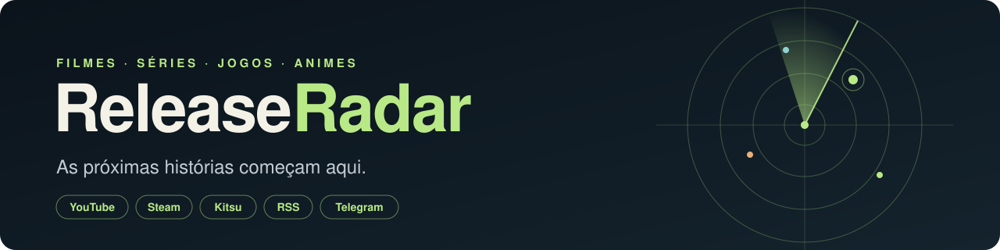
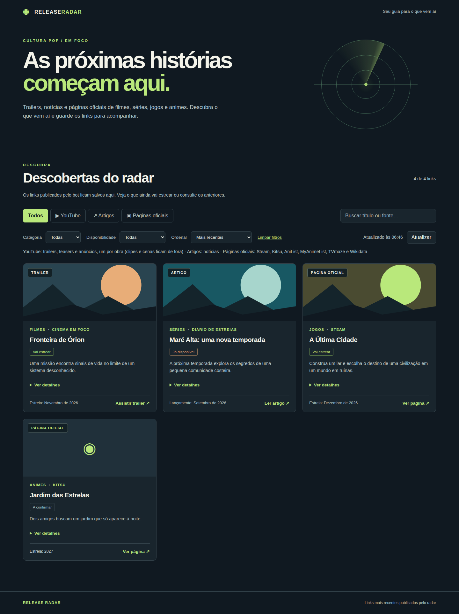
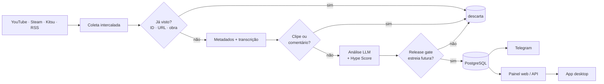
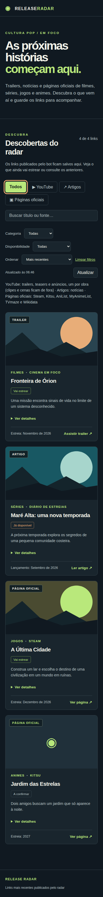
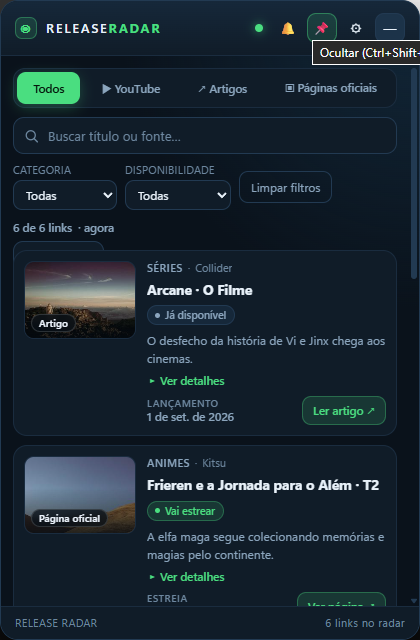

<div align="center">



# 📡 Release Radar

**Descubra o que vem por aí: filmes, séries, jogos e animes — antes de todo mundo.**

O bot varre trailers, notícias e páginas oficiais, uma LLM separa o que realmente
**ainda vai estrear**, e os links aprovados chegam no seu Telegram, no painel web e no
widget de desktop.

[](https://github.com/juninmd/release-radar/actions/workflows/build.yml)




</div>

---

## ✨ Destaques

- 🎬 **Quatro categorias:** filmes, séries, jogos e animes.
- 🔌 **Várias fontes, sem monopólio:** YouTube, Steam, Kitsu e RSS, intercaladas a cada rodada
  (novas fontes na [proposta](docs/FONTES.md)).
- 🧠 **Análise com LLM** (qualquer API compatível com OpenAI) e **Hype Score** de 0 a 100.
- 🚦 **Release gate:** só publica com data futura ou confirmação de que a obra ainda vai estrear.
- 🧹 **Sem repetição:** dedupe por ID, URL, conteúdo e **mesma obra** (vários trailers → um post).
- 🗣️ **Transcrição opcional** de trailers via Whisper.
- 🖥️ **Painel web** + **widget desktop** sempre no topo (Tauri + React).
- 🔒 **Seguro por padrão:** proteção contra SSRF/XXE/CSRF, API com token fora do localhost.

## 🧭 Como funciona



Uma obra já lançada, ou com estreia hoje ou no passado, **não é publicada**. Datas explícitas
das fontes têm prioridade sobre a análise; sem a chave da LLM, Steam e Kitsu ainda indicam obra
futura, mas YouTube e RSS precisam de evidência adicional (`Estreia futura nao confirmada`).

## 🚀 Início rápido

Requisitos: Python 3.11+, [uv](https://docs.astral.sh/uv/) e PostgreSQL
(ffmpeg e um serviço Whisper só para transcrever áudio).

```bash
git clone https://github.com/juninmd/release-radar.git && cd release-radar
uv sync --locked
cp .env.example .env        # preencha POSTGRES_*, LLM_* e TELEGRAM_*

uv run release-radar run --dry-run --limit 3   # teste: não grava nem publica
uv run release-radar run --limit 12            # rodada real
uv run release-radar web                       # http://127.0.0.1:8765
```

`--json` devolve o resultado em JSON para automações. O painel escuta só em `localhost`;
para expor, defina `RELEASE_RADAR_API_TOKEN` e use `--host 0.0.0.0` atrás de HTTPS.

## 🔌 Fontes e configuração

| Fonte | Categoria | Variáveis | Observação |
|---|---|---|---|
| YouTube | todas | `YOUTUBE_SOURCES`, `SOURCE_LIMIT` | Canais; única com transcrição de áudio |
| Steam | jogos | `STEAM_ENABLED`, `STEAM_LIMIT`, `STEAM_COUNTRY`, `STEAM_LANGUAGE` | Jogos "em breve" |
| Kitsu | animes | `KITSU_ENABLED`, `KITSU_LIMIT` | Animes `upcoming` |
| RSS / Atom | por feed | `RSS_SOURCES`, `RSS_LIMIT` | RSS 2.0, RDF e Atom |

Listas usam `categoria|endereço` separados por vírgula; categorias: `movies`, `series`,
`games`, `anime`. Todas as variáveis estão em [`.env.example`](.env.example).

**Em breve:** TMDB, TVmaze, AniList, Jikan, IGDB e mais — veja a
[proposta de novas fontes](docs/FONTES.md).

## 🖼️ Telas

<table>
  <tr>
    <td></td>
    <td></td>
  </tr>
  <tr><td align="center">Painel (celular)</td><td align="center">Widget desktop</td></tr>
</table>

Capturas com dados fictícios, geradas pela UI real. Mais em [docs/ui-preview.md](docs/ui-preview.md).

## 🖥️ App desktop

Janela compacta sempre no topo, bandeja, notificações, atalho global `Ctrl+Shift+R`, skins e
atualização assinada. Consome a API do painel (não fala direto com banco nem Telegram).
Detalhes em [desktop/README.md](desktop/README.md).

## 🔗 API

| Rota | Acesso | Descrição |
|---|---|---|
| `GET /api/releases` | aberta | 120 links mais recentes publicados |
| `GET /api/health` | aberta | Saúde do serviço |
| `POST`/`GET /api/run` | token | Dispara e acompanha uma rodada |
| `GET`/`PUT /api/settings` | token | Fontes e limites editáveis |

Com `RELEASE_RADAR_API_TOKEN` definido, as rotas protegidas exigem
`Authorization: Bearer <token>`. Sem token, fora do localhost, respondem `403`
(`RELEASE_RADAR_ALLOW_ANON=true` libera conscientemente). Tokens do Telegram, chaves da LLM e
transcrições nunca saem pela API.

## 🐳 Container

```bash
docker run --env-file .env ghcr.io/juninmd/release-radar:latest          # uma rodada
docker run --env-file .env -p 8765:8765 ghcr.io/juninmd/release-radar:latest \
  uv run release-radar web --host 0.0.0.0
```

## 🧪 Desenvolvimento

```bash
uv run ruff check . && uv run pytest -q && uv build
```

Testes de banco usam `RELEASE_RADAR_TEST_DSN` (schema isolado por teste) ou `pgserver`;
testes de navegador exigem `uv sync --locked --group browser` e Chromium. Nenhum teste acessa
fontes externas ou o Telegram. Veja [CONTRIBUTING.md](CONTRIBUTING.md).

## 🗂️ Estrutura

```
src/release_radar/   bot, pipeline, fontes, API e painel web
  sources/           steam, kitsu, rss
frontend/            TypeScript do painel (compila para static/)
desktop/             app Tauri v2 + React
tests/               pytest (banco, API, fontes, navegador)
docs/                capturas e proposta de fontes
```

## 🔐 Segurança

Veja [SECURITY.md](SECURITY.md) para reportar vulnerabilidades de forma privada.
Nunca versione `.env`, tokens ou chaves.

## 📄 Licença

[MIT](LICENSE).
